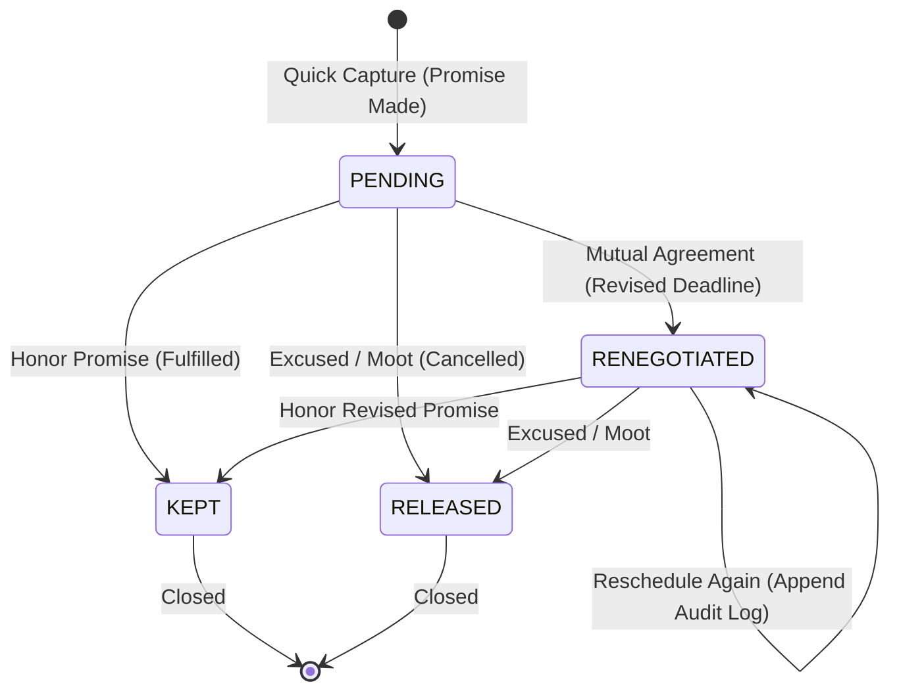

# Kept 🤝

> **A lightweight, offline-first native Android commitment ledger.**  
> Track promises made to other people with explicit, dignified closure: **Kept**, **Renegotiated**, or **Released**.

[-3DDC84.svg?style=flat&logo=android)](https://developer.android.com)
[](https://kotlinlang.org)
[](https://developer.android.com/jetpack/compose)
[](ARCHITECTURE.md)
[](#privacy--zero-permission-guarantee)
[](LICENSE)

---

## 📌 Table of Contents
- [Overview](#-overview)
- [Why Kept? (The Problem with Todo Apps)](#-why-kept-the-problem-with-todo-apps)
- [Core Domain Models & Lifecycle ("The DOMs")](#-core-domain-models--lifecycle-the-doms)
- [User Experience & Screen Design](#-user-experience--screen-design)
- [System Architecture & Engineering Highlights](#-system-architecture--engineering-highlights)
- [Privacy & Zero-Permission Guarantee](#-privacy--zero-permission-guarantee)
- [Milestone Roadmap & Progress](#-milestone-roadmap--progress)
- [Project Setup & Building the APK](#-project-setup--building-the-apk)
- [Download & Installation](#-download--installation)
- [Running Automated Tests](#-running-automated-tests)
- [Author & Credits](#-author--credits)

---

## 🎯 Overview

**Kept** is an independent native Android application purpose-built to help people remember, track, and close commitments made to other people.

Every day, we make casual commitments:
- *"I'll email you the quarterly budget by 5 PM."*
- *"I'll give you a call after lunch."*
- *"I'll review your pull request on Monday morning."*
- *"I'll introduce you to the hiring manager this week."*

**Kept is NOT a generic task manager, CRM, or team collaboration tool.**  
It is an intentional, personal **integrity ledger**. It focuses on the relational counterparty (the person you promised) and ensures no commitment is left hanging in limbo.

---

## 🔍 Why Kept? (The Problem with Todo Apps)

| Generic Todo & Task Apps | Kept Commitment Ledger |
|---|---|
| **Self-centered**: Tasks like "Buy milk" or "Wash car" with no counterparty. | **Relational**: Tracks promises made *to people* ("Sarah", "Dr. Mehta", "Acme Client"). |
| **Binary state**: Only `Done` or `Undone`. | **Explicit tri-state closure**: `Kept`, `Renegotiated`, or `Released`. |
| **Guilt-driven postponement**: Overdue tasks sit indefinitely with overdue red badges. | **Dignified renegotiation**: Rescheduling is logged in an immutable audit trail with an explicit reason. |
| **Feature bloat**: Subtasks, Kanban boards, P1/P2 priorities, project trees, tags. | **Focused clarity**: Quick capture, overdue banner, today's promises, and evening triage. |
| **Cloud/Tracking**: Cloud account required, telemetry, intrusive contacts syncing. | **100% Offline & Private**: Zero network permissions in manifest, zero address book scraping. |

---

## 🧬 Core Domain Models & Lifecycle ("The DOMs")

In Kept, every commitment follows an explicit finite state machine:



### 1. `Commitment` (The Primary DOM)
The core record representing an interpersonal promise:
- **`recipientName`**: The person or party to whom the commitment was made.
- **`title`**: Concise summary of what was promised ("Send Q3 Proposal").
- **`notes`**: Context or details.
- **`originalDueTimestamp`**: Original UTC epoch timestamp.
- **`currentDueTimestamp`**: Current active UTC epoch timestamp (updated on renegotiation).
- **`status`**: Current lifecycle state (`PENDING`, `RENEGOTIATED`, `KEPT`, `RELEASED`).
- **`createdAt`**: UTC epoch instant of capture.
- **`closedAt`**: UTC epoch instant when kept or released.
- **`reminderOffsetMinutes`**: Pre-deadline reminder offset (default: `0` = at due time; `15m`, `1h`, `1d`, `null`).

### 2. `RenegotiationRecord` (The Integrity Audit DOM)
Captures every deadline revision without user shame:
- **`commitmentId`**: Foreign key linked via `CASCADE` deletion.
- **`previousDueTimestamp`**: What the deadline was before revision.
- **`revisedDueTimestamp`**: The newly agreed deadline.
- **`reason`**: Optional note explaining the renegotiation ("Client requested more time", "Awaiting feedback").
- **`createdAt`**: Exact UTC timestamp when the revision occurred.

### 3. `RecipientSuggestion` (The Privacy-Preserving Counterparty DOM)
- Generated on-the-fly from the local commitment database:
  ```sql
  SELECT recipient_name FROM commitments 
  WHERE recipient_name != '' AND recipient_name LIKE :prefix || '%' 
  GROUP BY recipient_name 
  ORDER BY MAX(created_at) DESC 
  LIMIT :limit
  ```
- Instant autocomplete without ever requesting Android's intrusive `READ_CONTACTS` permission!

---

## 📱 User Experience & Screen Design

Kept features a calm, focused Material 3 interface designed for speed and clarity:

### 1. The Relational Ledger (Home Surface)
```
┌──────────────────────────────────────────────┐
│  Kept              📅 Thursday, Nov 13  🌙 ⚙ │
├──────────────────────────────────────────────┤
│ ⚠️ OVERDUE (Needs Attention)                 │
│  ┌────────────────────────────────────────┐  │
│  │ 👤 Sarah Jenkins • Yesterday, 5:00 PM  │  │
│  │ "Send finalized design assets"         │  │
│  │ [ ✓ Kept ]   [ 🔄 Renegotiate ]        │  │
│  └────────────────────────────────────────┘  │
│                                              │
│ 📌 TODAY (Due before midnight)               │
│  ┌────────────────────────────────────────┐  │
│  │ 👤 Dr. Mehta • Today, 4:30 PM          │  │
│  │ "Share lab test results"               │  │
│  │ [ ✓ Kept ]   [ 🔄 Renegotiate ]        │  │
│  └────────────────────────────────────────┘  │
│                                              │
│ ⏳ UPCOMING                                  │
│  • Tomorrow: Alex (Call regarding sync)      │
│  • Next Week: Acme Corp (Contract review)    │
│                                              │
│                                        [ + ] │
└──────────────────────────────────────────────┘
```

### 2. Quick Capture Sheet (Bottom Sheet)
- **Fast input**: Recipient label with recent chips (`[Sarah]`, `[Alex]`).
- **Description**: What you promised.
- **Quick Time Chips**: `[Today 5 PM]`, `[Tonight 8 PM]`, `[Tomorrow 10 AM]`, `[Pick Date...]`.
- **Reminder Options**: Default at due time, 15m, 1h, 1d, none.

### 3. Detail & Renegotiation Surface
- Displays full promise history.
- Audit trail showing previous revisions (e.g. *"Rescheduled twice: May 12 → May 14 → May 18: 'Awaiting client response'"*).
- One-tap actions: **Mark Kept**, **Renegotiate**, **Release**.

### 4. End-of-Day (EOD) Review
- Scheduled evening check-in (default 8:30 PM local time).
- Rapid card triage: *"Did you close your promises today?"*
- Triage today's remaining commitments before going to sleep.

---

## 🏗️ System Architecture & Engineering Highlights

Kept follows modern Android engineering best practices with Unidirectional Data Flow (UDF):

```
                      ┌──────────────────────┐
                      │    Compose UI Layer  │
                      │ (Ledger/Capture/EOD) │
                      └──────────┬───────────┘
                                 │ Observes StateFlow
                                 ▼
                      ┌──────────────────────┐
                      │      ViewModels      │
                      └──────────┬───────────┘
                                 │ Dispatches Intent
                                 ▼
                      ┌──────────────────────┐
                      │   Domain UseCases    │
                      └──────────┬───────────┘
                                 │ Calls Repository
                                 ▼
                      ┌──────────────────────┐
                      │ CommitmentRepository │
                      └──────────┬───────────┘
                                 │ Reads/Writes
                                 ▼
                      ┌──────────────────────┐
                      │     Room SQLite      │
                      │ (commitments/reneg)  │
                      └──────────────────────┘
```

### Android Engineering Patterns
- **Kotlin 2.2.10** with Google KSP (`2.2.10-2.0.2`).
- **Jetpack Compose & Material 3** with dynamic theming.
- **Room Persistence (`2.7.2`)**: Fully indexed relational tables, `ForeignKey.CASCADE` constraint, and type converters.
- **Atomic Transactions**: `database.withTransaction` guarantees consistency when inserting renegotiation logs and updating commitment due dates.
- **Hybrid Reminder Engine**:
  - `AlarmManager.setExactAndAllowWhileIdle()` when exact alarm capability is present.
  - Graceful fallback to inexact window alarm if exact alarms are disallowed.
  - `WorkManager` for flexible End-of-Day review background scheduling.
- **Device Resilience**: Alarms automatically restored on device reboot (`BootReceiver`) and app package updates (`PackageReplacedReceiver`).
- **Timezone Safety**: All timestamps stored strictly in UTC epoch milliseconds (`Instant.toEpochMilli()`). UI presentations format dynamically using device `ZoneId.systemDefault()`.

---

## 🔒 Privacy & Zero-Permission Guarantee

Kept is designed with privacy as an uncompromisable constraint:

| Potential Concern | Kept's Design Guarantee |
|---|---|
| **Internet Access** | **ZERO**: The merged `AndroidManifest.xml` **omits** `android.permission.INTERNET`. No bytes ever leave your device. |
| **Contacts Scraping** | **ZERO**: `READ_CONTACTS` is strictly forbidden. Recipient autocomplete only queries your previous Kept entries. |
| **Telemetry / Tracking** | **ZERO**: No Firebase, no Google Analytics, no Crashlytics, no third-party SDK trackers. |
| **Data Ownership** | 100% stored in local SQLite database on your device sandbox. |

---

## 🗺️ Milestone Roadmap & Progress

- [x] **Milestone 1: Core Foundation & Data Layer** ✅ *(Completed)*
  - Room entities, DAOs, reactive Flow queries, atomic repository, DateTimeUtils, 18/18 Unit Tests Passing.
- [ ] **Milestone 2: State Machine & Business Logic** ⏳ *(Next)*
  - Pure domain models, UseCases (`CreateCommitment`, `MarkKept`, `Renegotiate`, `Release`, `GetActiveCommitments`).
- [ ] **Milestone 3: Ledger UI & Quick Capture**
  - Jetpack Compose Ledger screen, Overdue/Today/Upcoming sections, Quick Capture Bottom Sheet.
- [ ] **Milestone 4: Detail, Renegotiation Flow & End-of-Day Review**
  - Full audit timeline, Reschedule dialog, EOD review triage workflow, History ledger.
- [ ] **Milestone 5: Reminder & Scheduling Engine**
  - AlarmManager scheduler, heads-up notifications with quick action buttons, BootReceiver, WorkManager EOD alert.
- [ ] **Milestone 6: Share Target Intake, Polish & Production Release**
  - Android Share Sheet integration (`ACTION_SEND`), edge-to-edge system bars, final release APK.

---

## ⚙️ Project Setup & Building the APK

### Prerequisites
- **Android Studio**: Ladybug, Meerkat, or newer (with Android SDK 35/37 installed).
- **JDK**: Java 17, 21, or 22 installed locally.
- **Operating System**: macOS, Linux, or Windows.

### Build via Command Line

1. **Clone the repository:**
   ```bash
   git clone https://github.com/AdwaitPr/Kept.git
   cd Kept
   ```

2. **Assemble the Debug APK:**
   ```bash
   ./gradlew assembleDebug
   ```
   The compiled APK will be located at:
   ```
   app/build/outputs/apk/debug/app-debug.apk
   ```

3. **Install directly onto a connected Android device or emulator:**
   ```bash
   adb install -r app/build/outputs/apk/debug/app-debug.apk
   ```

---

## 📥 Download & Installation

You can get the application using any of the following methods:

### Option 1: Direct APK Download
- Navigate to the [Releases](https://github.com/AdwaitPr/Kept/releases) section of this repository.
- Download `app-debug.apk` directly onto your Android device (Android 8.0 Oreo or newer).
- Tap the downloaded file to install (allow "Install from Unknown Sources" if prompted).

### Option 2: Build from Source
Follow the [Build via Command Line](#build-via-command-line) instructions above using `./gradlew assembleDebug`.

---

## 🧪 Running Automated Tests

Kept includes comprehensive unit tests testing Room in-memory database queries, cascading deletions, atomic repository transactions, and date/time boundary math.

To execute the test suite:
```bash
./gradlew testDebugUnitTest
```

### Verified Test Suite:
```
com.clickretina.kept.data.local.CommitmentDaoTest
  ✔ insertAndRetrieveCommitmentById
  ✔ observeActiveCommitmentsFiltersOutClosed
  ✔ observeOverdueCommitmentsReturnsOnlyPastDueActive
  ✔ foreignKeyCascadeDeletesRenegotiationsWhenCommitmentDeleted
  ✔ recipientSuggestionsQueryReturnsDistinctMatches

com.clickretina.kept.data.repository.CommitmentRepositoryTest
  ✔ createCommitmentCalculatesReminderSchedule
  ✔ renegotiateAtomicallyUpdatesCommitmentAndLogsHistory
  ✔ markKeptTransitionsStatusAndClearsReminder
  ✔ releaseTransitionsStatusAndClearsReminder
  ✔ renegotiateReturnsFalseForNonExistentCommitment

com.clickretina.kept.util.DateTimeUtilsTest
  ✔ toLocalDateTime and toEpochMillis roundtrip correctly
  ✔ getStartOfDay returns midnight instant of the same local day
  ✔ getEndOfDay returns 23h 59m 59s 999ms of the same local day
  ✔ isToday correctly identifies same day vs different days
  ✔ isOverdue correctly evaluates relative to reference timestamp
  ✔ computeReminderTriggerTime calculates correct offset
  ✔ formatRelativeDateTime renders friendly strings
```

---

## 👤 Author & Credits

**Adwait Pratap Singh**  
- GitHub: [@AdwaitPr](https://github.com/AdwaitPr)  
- Focus: Native Android Engineering, Offline-First Architecture, Material Design

---

## 📄 License
```
Copyright 2026 Adwait Pratap Singh

Licensed under the Apache License, Version 2.0 (the "License");
you may not use this file except in compliance with the License.
You may obtain a copy of the License at

    http://www.apache.org/licenses/LICENSE-2.0

Unless required by applicable law or agreed to in writing, software
distributed under the License is distributed on an "AS IS" BASIS,
WITHOUT WARRANTIES OR CONDITIONS OF ANY KIND, either express or implied.
See the License for the specific language governing permissions and
limitations under the License.
```
