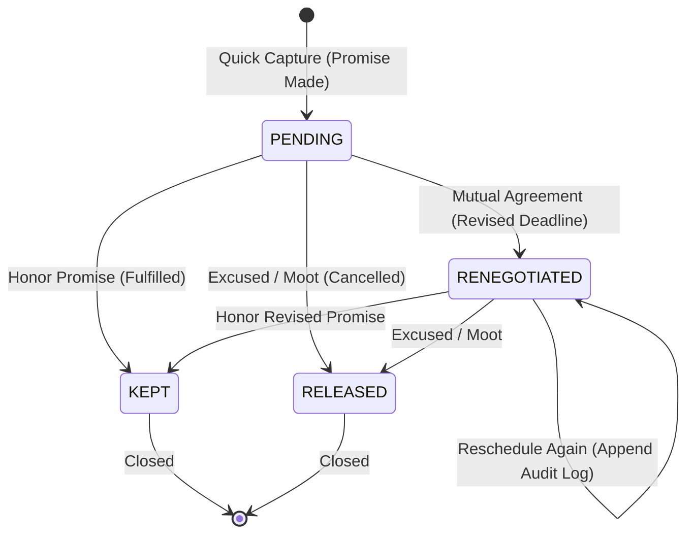
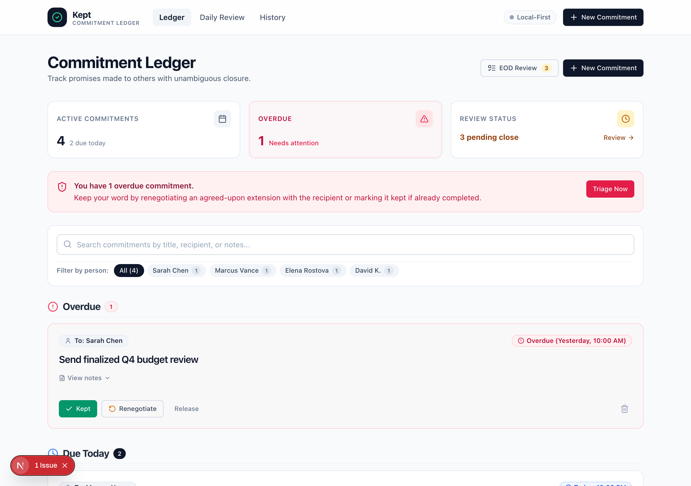
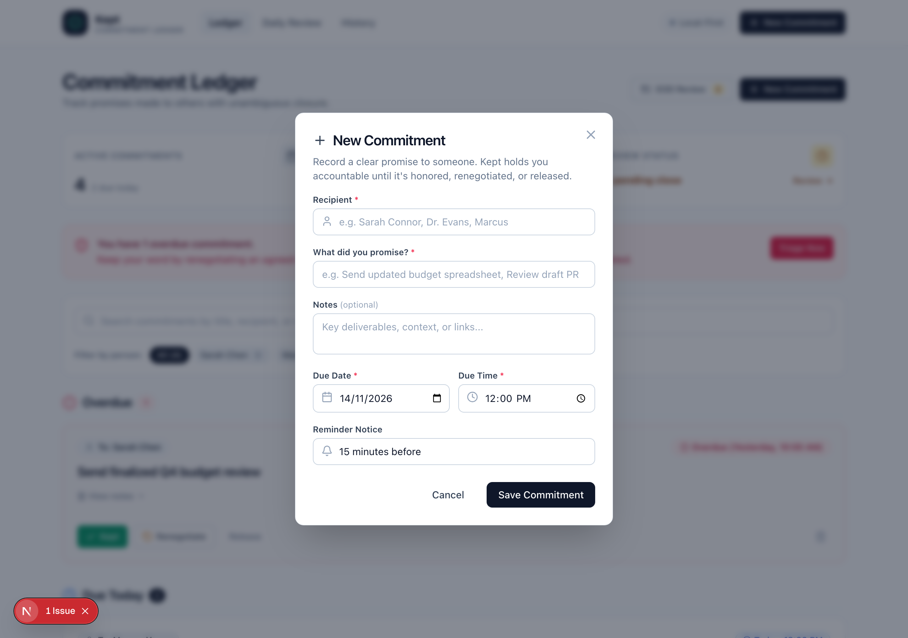
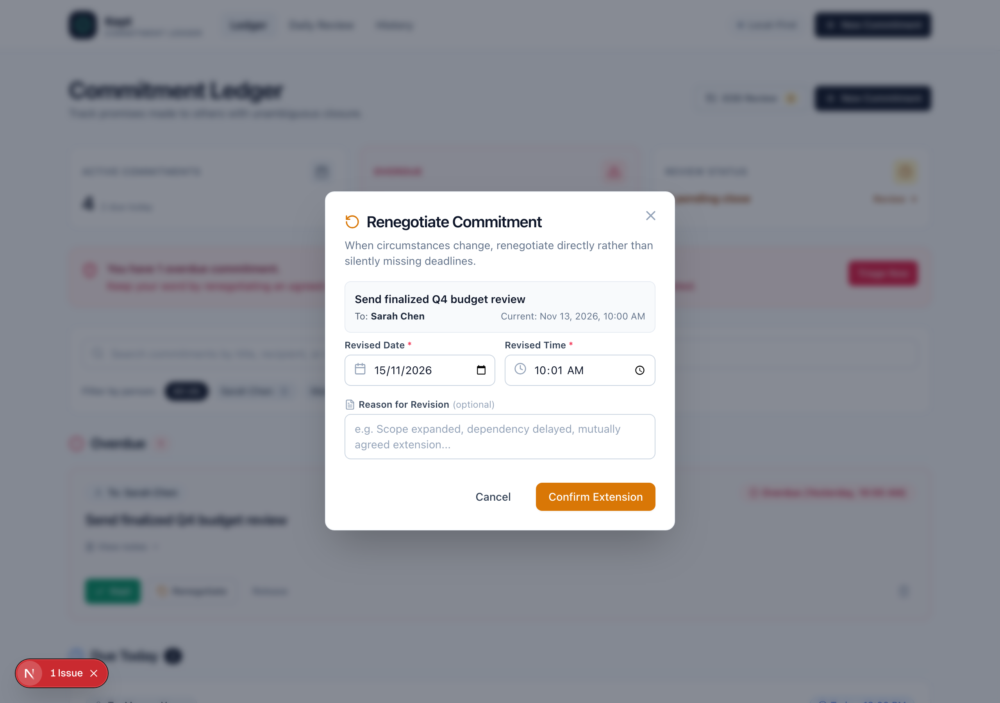
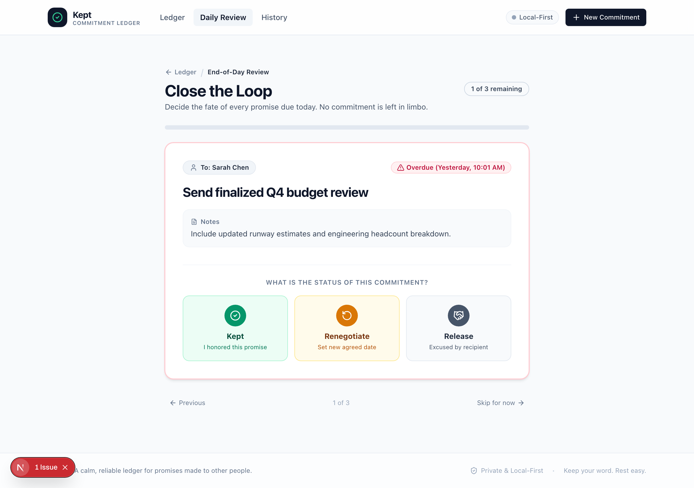
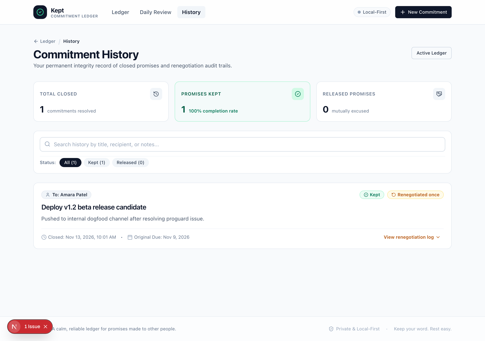
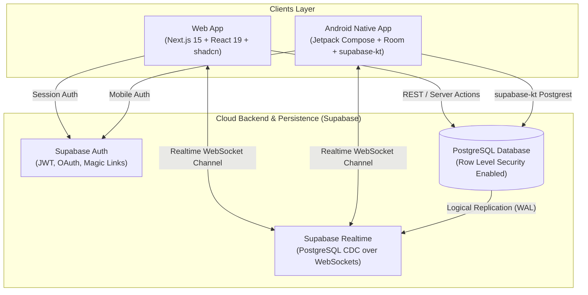

# Kept 🤝

> **A real-time synchronized interpersonal commitment ecosystem (Native Android & Next.js 15 Web Application).**  
> Track promises made to other people with explicit, dignified closure: **Kept**, **Renegotiated**, or **Released**.

[-3DDC84.svg?style=flat&logo=android)](https://developer.android.com)
[-black.svg?style=flat&logo=nextdotjs)](https://nextjs.org)
[](https://react.dev)
[](https://supabase.com)
[](https://kotlinlang.org)
[](https://tailwindcss.com)
[](ARCHITECTURE.md)
[](#privacy--zero-permission-guarantee)
[](LICENSE)

---

## 📌 Table of Contents
- [Overview](#-overview)
- [Why Kept? (The Problem with Todo Apps)](#-why-kept-the-problem-with-todo-apps)
- [Core Domain Models & Lifecycle ("The DOMs")](#-core-domain-models--lifecycle-the-doms)
- [Live Localhost Web Application & DOM Previews](#-live-localhost-web-application--dom-previews)
- [Full-Stack Real-Time Architecture](#-full-stack-real-time-architecture)
- [Privacy & Zero-Contact-Scraping Guarantee](#-privacy--zero-contact-scraping-guarantee)
- [Milestone Roadmap & Progress](#-milestone-roadmap--progress)
- [Web Application Setup & Localhost](#-web-application-setup--localhost)
- [Android App Setup & Building the APK](#-android-app-setup--building-the-apk)
- [Download & Installation](#-download--installation)
- [Running Automated Tests](#-running-automated-tests)
- [Author & Credits](#-author--credits)

---

## 🎯 Overview

**Kept** is an independent commitment ledger ecosystem purpose-built to help people remember, track, and close commitments made to other people.

Every day, we make casual commitments:
- *"I'll email you the quarterly budget by 5 PM."*
- *"I'll give you a call after lunch."*
- *"I'll review your pull request on Monday morning."*
- *"I'll introduce you to the hiring manager this week."*

**Kept is NOT a generic task manager, CRM, or team collaboration tool.**  
It is an intentional, personal **integrity ledger**. It focuses on the relational counterparty (the person you promised) and ensures no commitment is left hanging in limbo.

Whether you capture a promise on your **Android phone** on the go, or manage your commitments from your desktop on the **Next.js 15 Web Application**, both clients share the exact same database instances and synchronize live in real time.

---

## 🔍 Why Kept? (The Problem with Todo Apps)

| Generic Todo & Task Apps | Kept Commitment Ledger |
|---|---|
| **Self-centered**: Tasks like "Buy milk" or "Wash car" with no counterparty. | **Relational**: Tracks promises made *to people* ("Sarah", "Dr. Mehta", "Acme Client"). |
| **Binary state**: Only `Done` or `Undone`. | **Explicit tri-state closure**: `Kept`, `Renegotiated`, or `Released`. |
| **Guilt-driven postponement**: Overdue tasks sit indefinitely with overdue red badges. | **Dignified renegotiation**: Rescheduling is logged in an immutable audit trail with an explicit reason. |
| **Feature bloat**: Subtasks, Kanban boards, P1/P2 priorities, project trees, tags. | **Focused clarity**: Quick capture, overdue banner, today's promises, and evening triage. |
| **Address book scraping**: Uploads your contacts to third-party servers. | **Zero Contact Scraping**: Recipient autocomplete is populated strictly from local commitment history. |

---

## 🧬 Core Domain Models & Lifecycle ("The DOMs")

In Kept, every commitment follows an explicit finite state machine:



### 1. `Commitment` (The Primary DOM)
The core record representing an interpersonal promise:
- **`recipientName`**: The person or party to whom the commitment was made.
- **`title`**: Concise summary of what was promised ("Send Q3 Proposal").
- **`notes`**: Optional context or references.
- **`originalDueTimestamp`**: Immutable UTC epoch timestamp of the initial deadline.
- **`currentDueTimestamp`**: Active UTC epoch timestamp (updates upon renegotiation).
- **`status`**: Current state (`PENDING`, `RENEGOTIATED`, `KEPT`, `RELEASED`).
- **`createdAt`**: UTC epoch timestamp when the commitment was captured.
- **`closedAt`**: UTC epoch timestamp when closed as `KEPT` or `RELEASED`.
- **`reminderOffsetMinutes`**: When the user requested a heads-up alert.

### 2. `RenegotiationRecord` (The Relational Audit DOM)
An immutable ledger tracking every deadline modification:
- **`commitmentId`**: Foreign key to the parent commitment.
- **`previousDueTimestamp`**: UTC epoch timestamp of the superseded deadline.
- **`revisedDueTimestamp`**: New UTC epoch timestamp agreed upon (strictly enforced in the future).
- **`reason`**: Optional explanation for why the deadline was revised.
- **`createdAt`**: UTC epoch timestamp when the renegotiation occurred.

---

## 🖥️ Live Localhost Web Application & DOM Previews

The Next.js 15 Web Application runs locally on `http://localhost:3000` with instant hot-reloading and optimistic local-first state:

### 1. Main Ledger (`/`)
Categorized commitment sections (**Overdue**, **Due Today**, **Upcoming**) with real-time summary statistics, recipient tag filters, and one-tap closure actions (`Kept`, `Renegotiate`, `Release`):



---

### 2. Quick Capture Sheet
Fast keyboard-accessible modal to record new commitments. Features local recipient autocomplete, date/time pickers, and configurable reminder offsets:



---

### 3. Renegotiation Flow
Dignified rescheduling dialog that requires a revised future deadline and captures an audit reason for the ledger:



---

### 4. End-of-Day Review (`/review`)
A calm evening triage deck (defaults to 8:30 PM local time). Lets you step through unclosed promises due today and make explicit closures:



---

### 5. Commitment History (`/history`)
Historical ledger showing all closed commitments (`KEPT` and `RELEASED`), overall kept rate metrics, and expandable renegotiation audit trails:



---

## ⚡ Full-Stack Real-Time Architecture

The Web application and Android application share the same database instances and update simultaneously through **PostgreSQL Change Data Capture (CDC)** over persistent WebSockets:



### Real-Time Update Flow
1. **Action on Android**: You mark a commitment as `KEPT` on your phone.
2. **Postgres CDC Trigger**: Supabase commits the update and writes to the Write-Ahead Log (WAL).
3. **WebSocket Broadcast**: Supabase Realtime pushes the change event over WebSockets to all connected clients.
4. **Instant Web UI Reaction**: The Next.js web application catches the event and immediately transitions the commitment to `KEPT` without reloading!

---

## 🛡️ Privacy & Zero-Contact-Scraping Guarantee

Kept enforces strict architectural boundaries to respect user privacy:

1. **Zero Contact Scraping (`READ_CONTACTS` Forbidden)**:  
   Kept never accesses your address book or personal contacts. Recipient suggestions in both Web and Android are populated exclusively by querying your own past commitment history (`SELECT recipient_name ... GROUP BY recipient_name`).
2. **Row-Level Security (RLS)**:  
   PostgreSQL enforces zero-trust data access:
   ```sql
   CREATE POLICY "Users can only access their own commitments"
       ON public.commitments FOR ALL
       USING (auth.uid() = user_id);
   ```
3. **Local-First Resilience**:  
   Both web and mobile clients function with full interactivity even when disconnected from the cloud.

---

## 🗺️ Milestone Roadmap & Progress

- [x] **Milestone 1: Core Foundation & Data Layer** ✅ *(Completed)*
  - Room entities, DAOs, reactive Flow queries, atomic repository, DateTimeUtils, 18/18 Unit Tests Passing.
- [x] **Web Full-Stack & Real-Time Sync Expansion** ✅ *(Completed)*
  - Next.js 15 App Router, React 19, Tailwind CSS, shadcn/ui components, Supabase migrations, Zustand store, live DOM screenshots, 83/83 Web Unit Tests Passing.
- [ ] **Milestone 2: State Machine & Business Logic** ⏳ *(Next)*
  - Pure domain models, UseCases (`CreateCommitment`, `MarkKept`, `Renegotiate`, `Release`, `GetActiveCommitments`).
- [ ] **Milestone 3: Ledger UI & Quick Capture (Android)**
  - Jetpack Compose Ledger screen, Overdue/Today/Upcoming sections, Quick Capture Bottom Sheet.
- [ ] **Milestone 4: Detail, Renegotiation Flow & End-of-Day Review (Android)**
  - Full audit timeline, Reschedule dialog, EOD review triage workflow, History ledger.
- [ ] **Milestone 5: Reminder & Scheduling Engine**
  - AlarmManager scheduler, heads-up notifications with quick action buttons, BootReceiver, WorkManager EOD alert.
- [ ] **Milestone 6: Share Target Intake, Polish & Production Release**
  - Android Share Sheet integration (`ACTION_SEND`), edge-to-edge system bars, final release APK.

---

## 🌐 Web Application Setup & Localhost

### Prerequisites
- **Node.js**: v20 or newer (`node -v`)
- **npm**: v10 or newer

### Run in Localhost
1. Navigate to the `web/` directory:
   ```bash
   cd web
   ```
2. Install dependencies:
   ```bash
   npm install
   ```
3. Launch the development server:
   ```bash
   npm run dev
   ```
4. Open [http://localhost:3000](http://localhost:3000) in your browser.

---

## ⚙️ Android App Setup & Building the APK

### Prerequisites
- **Android Studio**: Ladybug, Meerkat, or newer (with Android SDK 35/37 installed).
- **JDK**: Java 17, 21, or 22 installed locally.

### Assemble the Debug APK
```bash
./gradlew assembleDebug
```
The compiled APK will be located at:
```
app/build/outputs/apk/debug/app-debug.apk
```

---

## 📥 Download & Installation

### Option 1: Direct APK Download
- Navigate to the [Releases](https://github.com/AdwaitPr/Kept/releases) section of this repository.
- Download `app-debug.apk` directly onto your Android device (Android 8.0 Oreo or newer).
- Tap the downloaded file to install (allow "Install from Unknown Sources" if prompted).

### Option 2: Build from Source
```bash
git clone https://github.com/AdwaitPr/Kept.git
cd Kept
./gradlew assembleDebug
adb install -r app/build/outputs/apk/debug/app-debug.apk
```

---

## 🧪 Running Automated Tests

### Web Application Tests (Vitest)
```bash
cd web
npm test
# Output: 83 passed across 8 test suites (0 failures)
```

### Android Unit & DAO Tests (JUnit & Robolectric)
```bash
./gradlew testDebugUnitTest
# Output: 18/18 tests passed (0 failures, 0 errors)
```

---

## 👤 Author & Credits

- **Author**: Adwait Pratap Singh ([@AdwaitPr](https://github.com/AdwaitPr))
- **Project**: Kept (`com.clickretina.kept`)
- **License**: Apache 2.0 (see [LICENSE](LICENSE))
